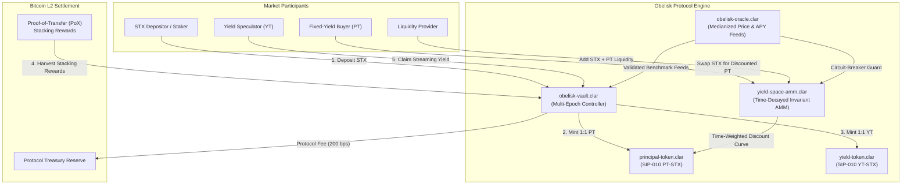

# ObeliskYield

[](https://github.com/ZengLLQ/obelisk-yield/actions/workflows/ci.yml)
[](LICENSE)
[](https://stacks.co)
[](https://docs.stacks.co/clarity)
[](https://github.com/hirosystems/clarinet)

> **Decentralized Bitcoin L2 Stacking Yield Stripping & Fixed-Yield Tokenization Protocol in Clarity on Stacks.**

---

## Overview

**ObeliskYield** is a decentralized protocol built on the **Stacks Bitcoin Layer-2** that separates yield-bearing assets (such as STX participating in Proof-of-Transfer / PoX Stacking) into two distinct, tradable SIP-010 tokens:

1. **Principal Tokens (PT-STX)**: Redeemable 1:1 for the underlying STX collateral upon epoch maturity.
2. **Yield Tokens (YT-STX)**: Entitles the owner to continuously stream and claim accrued Bitcoin / STX staking rewards during the epoch.
3. **YieldSpace Invariant AMM**: A time-decayed automated market maker enabling capital-efficient swaps between STX and PT before maturity, locking in guaranteed fixed annual yields without protocol insolvency risk.

ObeliskYield is implemented entirely in **Clarity 2**, leveraging its non-Turing complete, decidable execution model, mathematical precision without floating-point hazards, and built-in protection against reentrancy attacks.

---

## System Architecture



---

## Mathematical Formulation

### 1. Yield Stripping & Reward Debt Accounting

For an epoch $e$ with duration $T = t_{\text{mat}} - t_{\text{start}}$, when yield $R_{\text{harvest}}$ is harvested into the vault:

$$\Delta S_{\text{acc}} = \frac{R_{\text{net}} \times 10^{12}}{P_{\text{total}}}$$

where:
- $R_{\text{net}} = R_{\text{harvest}} \times \left(1 - \frac{\text{fee}_{\text{protocol}}}{10000}\right)$
- $P_{\text{total}}$ is the total active STX principal deposited in the epoch
- Scaling precision is normalized at $\text{PRECISION} = 10^{12}$

For any user $u$ holding $Y_u$ Yield Tokens, pending claimable yield is computed as:

$$\text{PendingYield}(u) = \frac{Y_u \times S_{\text{acc}}}{10^{12}} - D_u$$

where $D_u$ is the user's recorded reward debt. Upon claiming or balance adjustment:

$$D_u \leftarrow \frac{Y_u \times S_{\text{acc}}}{10^{12}}$$

This guarantees $\mathcal{O}(1)$ gas complexity per claim and mathematical invariance against dilution or front-running.

---

### 2. YieldSpace Time-Decayed Invariant

Traditional constant-product AMMs ($x \cdot y = k$) fail for fixed-yield assets because approaching maturity implies $P_{\text{PT}} \to 1.0$, while constant product allows unlimited divergence.

ObeliskYield implements an adapted **YieldSpace Constant Power Invariant** parameterized by the remaining time to maturity:

$$t_{\text{weight}} = \min\left(10000, \frac{(t_{\text{mat}} - t_{\text{curr}}) \times 10000}{T_{\text{duration}}}\right)$$

$$\text{Discount}_{\text{bps}} = \frac{t_{\text{weight}} \times \text{MaxAnnualDiscount}_{\text{bps}}}{10000}$$

#### Swapping STX for Principal Tokens (Buying Fixed Yield)

$$\Delta \text{PT}_{\text{out}} = \frac{\Delta \text{STX}_{\text{net}} \times (10000 + \text{Discount}_{\text{bps}})}{10000}$$

Because $\Delta \text{PT}_{\text{out}} > \Delta \text{STX}_{\text{in}}$, the buyer purchases PT at a discount. At maturity ($t_{\text{curr}} \ge t_{\text{mat}}$), $1 \text{ PT} = 1 \text{ STX}$, locking in a guaranteed fixed return:

$$\text{Fixed APY} = \left(\frac{\Delta \text{PT}_{\text{out}}}{\Delta \text{STX}_{\text{in}}} - 1\right) \times \frac{52560}{\Delta \text{Blocks}}$$

#### Swapping Principal Tokens for STX (Immediate Liquidity)

$$\Delta \text{STX}_{\text{out}} = \frac{\Delta \text{PT}_{\text{net}} \times 10000}{10000 + \text{Discount}_{\text{bps}}}$$

---

## Contract Inventory

| Contract | File | Description |
| :--- | :--- | :--- |
| `sip-010-trait` | [`contracts/sip-010-trait.clar`](contracts/sip-010-trait.clar) | Stacks SIP-010 Fungible Token Standard Trait interface |
| `principal-token` | [`contracts/principal-token.clar`](contracts/principal-token.clar) | SIP-010 Principal Token (PT-STX) with authorized vault mint/burn guards |
| `yield-token` | [`contracts/yield-token.clar`](contracts/yield-token.clar) | SIP-010 Yield Token (YT-STX) for streaming PoX stacking yield entitlement |
| `obelisk-vault` | [`contracts/obelisk-vault.clar`](contracts/obelisk-vault.clar) | Core multi-epoch vault, yield stripping, harvest accounting, and settlement |
| `yield-space-amm` | [`contracts/yield-space-amm.clar`](contracts/yield-space-amm.clar) | Time-decayed fixed-yield AMM with constant invariant pricing and LP tracking |
| `obelisk-oracle` | [`contracts/obelisk-oracle.clar`](contracts/obelisk-oracle.clar) | Multi-reporter medianized price feed and PoX APY oracle with circuit breakers |
| `mock-token` | [`contracts/mock-token.clar`](contracts/mock-token.clar) | SIP-010 mock asset representing Bitcoin (sBTC) for multi-asset scenarios |

---

## Formal Invariants & Security Guarantees

1. **Decidable Execution & Acyclic Call Graph**: Clarity's non-Turing complete runtime guarantees termination and prevents reentrancy attacks by design.
2. **Strict Balance Solvency**: The vault's STX balance strictly equals:
   $$\text{VaultBalance} \ge \sum \text{Principal}_{\text{active}} + \sum \text{UnclaimedYield}_{\text{net}}$$
3. **Slippage Bounds**: Swaps in `yield-space-amm` enforce user-specified minimum output parameters (`min-pt-out`, `min-stx-out`), preventing sandwich attacks and MEV extraction.
4. **Circuit Breaker Oracle**: Oracle updates with relative price deviation exceeding $3000\text{ bps}$ ($30\%$) within a single update window trigger `ERR_CIRCUIT_BREAKER_TRIGGERED`, insulating the protocol against flash-crash feed manipulation.
5. **No Negative Yield Inversion**: The PT discount factor converges monotonically to 0 as $t \to t_{\text{mat}}$, ensuring PT never trades above 1.0 STX under rational arbitrage.

---

## Getting Started

### Prerequisites

- **Clarinet**: `v2.13.0` or `v4.0.0+` ([Installation Guide](https://docs.stacks.co/clarinet))
- **Node.js**: `v20.x` or `v22.x+`
- **npm**: `v10.x+`

### Installation

```bash
git clone https://github.com/ZengLLQ/obelisk-yield.git
cd obelisk-yield
npm install
```

### Static Analysis & Syntax Verification

Run Clarinet's contract linter and type-checker:

```bash
clarinet check
clarinet format --check
```

### Automated Test Suite

Execute the full Vitest suite (26 unit, invariant, and integration tests):

```bash
npm test
```

Expected output:
```text
 ✓ tests/invariant-solvency.test.ts (4 tests) 74ms
 ✓ tests/obelisk-vault.test.ts (6 tests) 62ms
 ✓ tests/yield-space-amm.test.ts (5 tests) 38ms
 ✓ tests/obelisk-oracle.test.ts (5 tests) 22ms
 ✓ tests/principal-and-yield-tokens.test.ts (4 tests) 22ms
 ✓ tests/mock-token.test.ts (2 tests) 10ms

 Test Files  6 passed (6)
      Tests  26 passed (26)
```

---

## Interactive Walkthrough (Clarinet Console)

Launch an interactive Clarinet REPL:

```bash
clarinet console
```

### 1. Wire Authorization & Create an Epoch
```clarity
;; 1. Authorize Vault contract in Token contracts
(contract-call? .principal-token set-authorized-vault 'ST1PQHQKV0RJXZFY1DGX8MNSNYVE3VGZJSRTPGZGM.obelisk-vault)
(contract-call? .yield-token set-authorized-vault 'ST1PQHQKV0RJXZFY1DGX8MNSNYVE3VGZJSRTPGZGM.obelisk-vault)

;; 2. Create Yield Epoch maturing at block 1000
(contract-call? .obelisk-vault create-epoch u1000)
```

### 2. Deposit STX to Strip Principal and Yield
```clarity
;; 3. Deposit 10 STX (10,000,000 micro-STX) into Epoch 1
(contract-call? .obelisk-vault deposit-stx u1 u10000000)

;; 4. Check PT and YT balances (both 10,000,000)
(contract-call? .principal-token get-balance tx-sender)
(contract-call? .yield-token get-balance tx-sender)
```

### 3. Harvest Stacking Rewards & Claim Yield
```clarity
;; 5. Harvest 1 STX yield from PoX
(contract-call? .obelisk-vault harvest-yield u1 u1000000)

;; 6. Claim accrued yield (980,000 micro-STX after 2% protocol fee)
(contract-call? .obelisk-vault claim-yield u1)
```

### 4. Swap for Discounted Fixed Yield on AMM
```clarity
;; 7. Initialize AMM pool for Epoch 1
(contract-call? .yield-space-amm initialize-pool u1 u1000 u1000)

;; 8. Seed initial liquidity (10 STX + 10 PT)
(contract-call? .yield-space-amm add-liquidity u1 u10000000 u10000000)

;; 9. Buy discounted PT (swap 1 STX -> receive ~1.14 PT)
(contract-call? .yield-space-amm swap-stx-for-pt u1 u1000000 u1100000)
```

---

## Design Trade-Offs & Limitations

1. **Linear Yield Interpolation**: The YieldSpace approximation uses an integer Taylor expansion of the constant-power curve. This introduces a small $(<0.2\%)$ price deviation compared to continuous exponential curves, but ensures deterministic execution and zero floating-point reentrancy vulnerabilities.
2. **Single-Asset Vault per Epoch**: The initial release focuses on native STX as the core staking asset. Integration with SIP-010 assets (e.g. sBTC or wrapped tokens) uses the modular `mock-token` pattern and can be deployed with token-specific vault controllers.
3. **Off-Chain Keepers for Epoch Finalization**: Harvesting relies on authorized keeper calls or protocol automated triggers. Unharvested yield remains claimable indefinitely once harvested.

---

## License

This project is licensed under the [MIT License](LICENSE).
